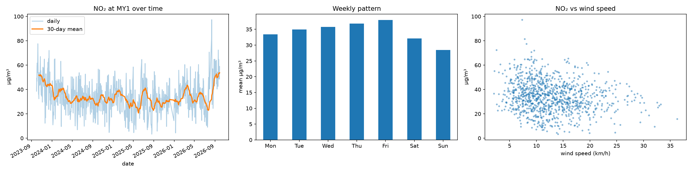
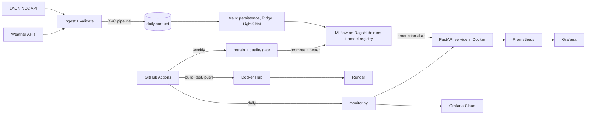

# London NO₂ Forecaster: an end-to-end MLOps project


Forecasts next-day nitrogen dioxide (NO₂) at a London roadside monitoring site (MY1, Marylebone Road) from live air-quality and weather data. The focus is the MLOps lifecycle around the model: versioned data, tracked experiments, a model registry, a containerised API, monitoring, CI/CD and quality-gated retraining.

## Results

Time-based split (train / validation ≈ 6 months / test ≈ 6 months), mean absolute error in µg/m³:

| Model | Validation MAE | Test MAE | Test RMSE |
|---|---|---|---|
| Persistence baseline (tomorrow = today) | 7.11 | 8.16 | 10.06 |
| Ridge regression | 5.37 | 6.66 | 8.54 |
| **LightGBM (registered, in production)** | **4.44** | **6.31** | **8.19** |

LightGBM reduces test MAE by **22.7%** against the persistence baseline. Most of that gain comes from the weather and calendar features (Ridge alone gets about 18%), so this is a modest improvement. It is based on one test window of about 160 days, and test error is higher than validation error.




## Architecture



## What each tool does

| Tool | Role |
|---|---|
| DVC | Versions the dataset and the ingest → validate pipeline; the data hash is tagged on every MLflow run |
| MLflow (hosted on DagsHub) | Experiment tracking and model registry; the API loads whatever holds the `production` alias |
| FastAPI + Docker | Serves forecasts; slim, non-root image with a health check |
| Prometheus + Grafana | Local monitoring of requests, errors, latency, loaded model and latest forecast |
| GitHub Actions | Tests, image build, container smoke test, Docker Hub push, Render redeploy, daily monitoring, weekly retraining |

## Design decisions worth knowing

- **Leakage-tested features.** Each row predicts the next day. A test changes every future NO₂ value and checks that no feature moves. All lags are by calendar day, so missing days can never shift a lag onto the wrong date.
- **The API refuses to guess through long data gaps.** If recent NO₂ history has gaps longer than 3 days it returns a 503 with the reason instead of a made-up forecast.
- **Resilient weather input.** The service tries MET Norway, then Open-Meteo, then a clearly flagged fallback using recent observed weather; the response reports which was used (`weather_source`).
- **Training/serving parity.** A test checks that the live weather aggregation matches the training code exactly.
- **Resilient model loading.** The registry `production` model is loaded at startup, with a copy baked into the image as a fallback if MLflow is unreachable.
- **Quality-gated retraining.** A weekly job trains a candidate on fresh data and scores it, alongside the current production model, on the latest 30 days. It is promoted only if its MAE is at least 1% lower; either way the decision is logged to MLflow.

## API

```bash
curl "https://london-air-quality-latest.onrender.com/forecast?site=MY1"
```

```json
{
  "site": "MY1",
  "based_on_date": "2026-10-17",
  "forecast_date": "2026-10-18",
  "predicted_no2_ugm3": 16.96,
  "model_version": "1",
  "model_source": "mlflow",
  "weather_source": "fallback_recent_observed"
}
```

Other endpoints: `/health`, `/metrics` (Prometheus), `/docs` (interactive).


## Run it locally

```bash
python -m venv .venv && source .venv/bin/activate
pip install -r requirements.txt && pip install -e .
python -m pytest -q

python -m aq.ingest && python -m aq.validate     # or: dvc repro
python -m aq.train                               # needs the MLflow variables below
python scripts/export_model.py                   # bakes the production model into model_baked/
docker compose up --build -d                     # API :8000, Prometheus :9090, Grafana :3000
```

Create a `.env` file (git-ignored) with `MLFLOW_TRACKING_URI`, `MLFLOW_TRACKING_USERNAME` and `MLFLOW_TRACKING_PASSWORD`.


## CI/CD and automation

| Workflow | Trigger | What it does |
|---|---|---|
| `ci.yml` | push / PR | tests; on `main`: export model, build image, smoke-test the container, push to Docker Hub, trigger a Render redeploy |
| `daily.yml` | daily 04:30 UTC | calls the API, logs the forecast, scores earlier forecasts against actual NO₂, checks input drift, pushes metrics, commits the prediction log |
| `retrain.yml` | weekly + manual | fetches fresh data, trains a candidate, applies the quality gate, restarts the API if promoted |

<!-- CLOUD-START -->
## Deployment and cloud monitoring

The image runs on a Render free web service, and the daily job pushes metrics to a Grafana Cloud dashboard: API status, latency and cold-start wake time, latest forecast, input drift, and predicted vs actual NO₂ with a rolling 7-forecast MAE. The predicted-vs-actual panels fill in over time, because a forecast can only be scored once the actual measurement is published.


<!-- CLOUD-END -->

## Limitations

- **One monitoring site** and one pollutant.
- **Training used observed weather where serving uses forecasts**, so real-world error will be somewhat higher than the test score. Serving also uses MET Norway data (m/s converted to km/h, sea-level pressure), which differs slightly from the training data.
- **Degraded mode is flagged, not hidden.** When only the fallback weather is available, forecasts are less accurate.
- **Scoring caveat.** The LAQN feed lags by a day or two, so a forecast date can be earlier than the run date; those forecasts used reanalysis weather, and their error is optimistic. The prediction log records `lead_days` and `weather_source` so they can be filtered.
- **The drift check is a simple heuristic**: a shift of more than one standard deviation against the same-month training average. It is not a statistical test.
- **The promotion gate compares 30 days**, a small sample, and promoted candidates have not seen those last 30 days.
- **Render free tier** sleeps when idle and takes up to a minute or two to wake. Grafana Cloud's free tier keeps 14 days of metrics.
- **Temporary override (to be removed after about 27 Oct 2026):** the gap-filling limit was raised from 3 to 5 days on the deployed service while LAQN had a 4-day outage (9–12 Oct 2026).

## Repository layout

```
src/aq/       ingest, validate, features, train, evaluate (quality gate), live (serving data), monitor
api/          FastAPI service
tests/        feature, leakage, live-data and API tests
monitoring/   Prometheus + Grafana configs, cloud dashboard, prediction log, reference stats
scripts/      export_model.py (bakes the production model into the image)
.github/      CI, daily monitor and retraining workflows
```

## Data and attribution

- Air quality: London Air Quality Network (LAQN).
- Weather: [MET Norway](https://api.met.no) and [Open-Meteo](https://open-meteo.com).
